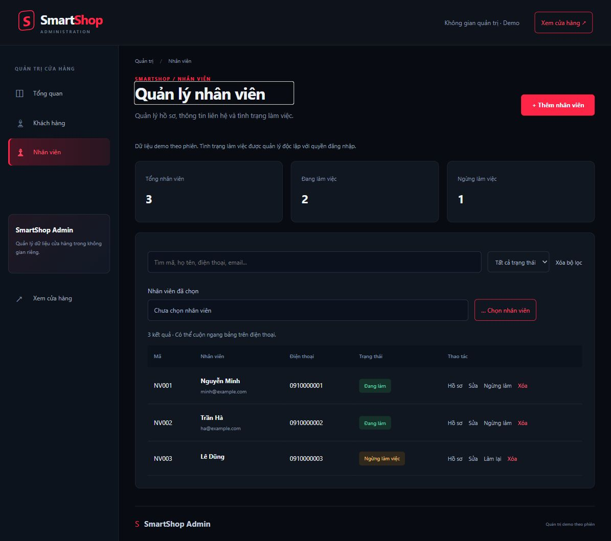
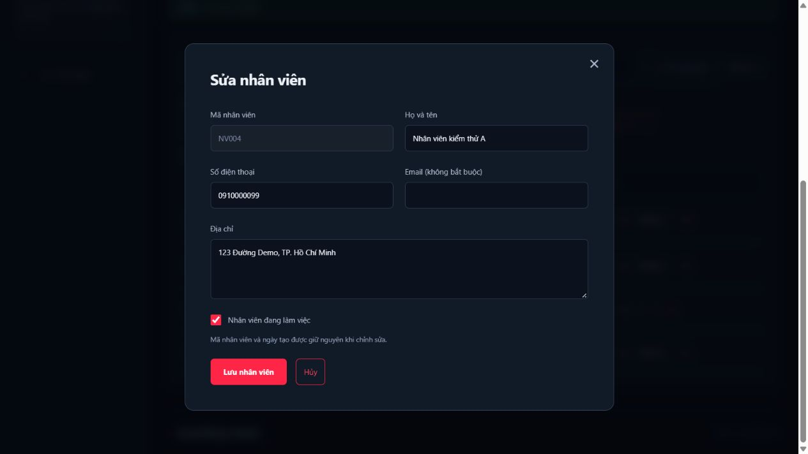
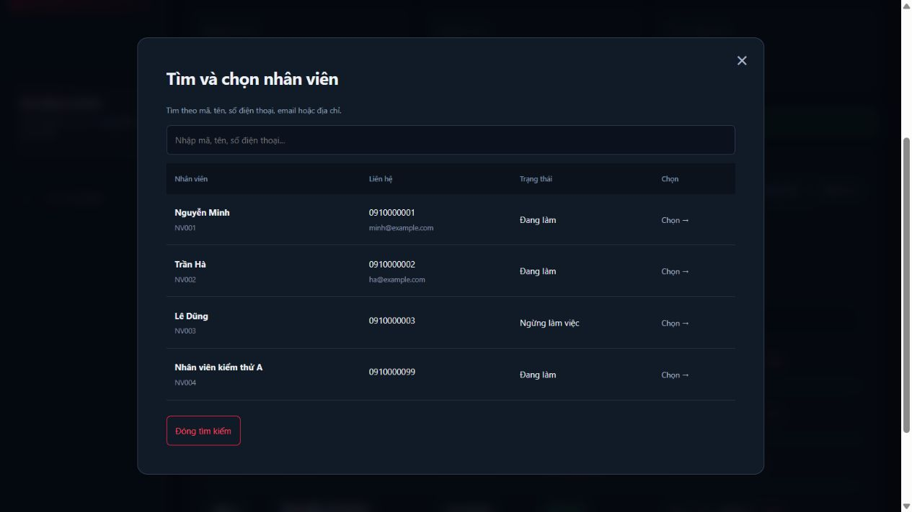
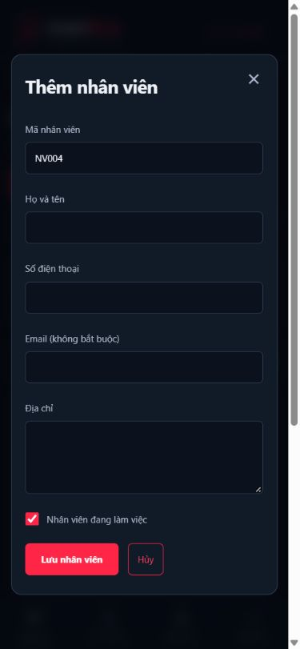

# Quản lý nhân viên — nháp báo cáo phần 06

## Chức năng

Trang `/admin/employees` nằm trong Admin, có menu trên desktop và điện thoại. Người quản trị có thể thêm, sửa, xem hồ sơ, xóa sau khi xác nhận, tìm theo mã/tên/điện thoại/email/địa chỉ và lọc tình trạng làm việc. Tìm tên tiếng Việt không cần nhập dấu.

Mã được gợi ý theo NV001, NV002...; chặn trùng không phân biệt hoa/thường. Mã và ngày tạo không được đổi khi sửa. Kiểm tra họ tên, số điện thoại, địa chỉ bắt buộc; email không bắt buộc nhưng phải đúng định dạng khi nhập. Form sửa dùng bản sao; hủy không đổi dữ liệu đã lưu.

## Kiến trúc và tái sử dụng

- GUI: `Admin/Components/Pages/Employees.razor` và các component EmployeeEditor, EmployeeProfile, EmployeePicker, EmployeeSelector.
- BUS: IEmployeeService/EmployeeService xử lý kiểm tra, CRUD và tìm kiếm trên ArrayList đã nạp một lần.
- DAO: IEmployeeRepository/DemoEmployeeRepository truy cập kho demo; BUS không tham chiếu lớp DAO cụ thể.
- DTO: Employee bất biến và EmployeeDraft dành cho form nhập.

Các lớp được ghép bằng dependency injection theo phiên. Giao diện dùng lại DataTable, ValidatedForm, FormField, ModalDialog và kiểu trình bày từ phần khách hàng. SearchText dùng chung cho khách hàng và nhân viên để chuẩn hóa tiếng Việt. Popup trả đối tượng bằng callback, có tham số OnlyActive để tái sử dụng trong nghiệp vụ quản trị.

## Kiểm tra

Build không có lỗi/cảnh báo. 29 kiểm tra nhân viên và 48 kiểm tra trước đó đều đạt, gồm CRUD, dữ liệu sai, mã trùng, khóa mã, tìm kiếm trên bộ nhớ, lỗi ghi DAO không làm lệch cache và tách dữ liệu theo phiên. Đã kiểm tra thao tác trực tiếp trên trình duyệt và bố cục 390 × 844.

## Phạm vi hiện tại

Dữ liệu lưu trong bộ nhớ theo phiên; chưa có SQL/MyConnection. Tình trạng làm việc chưa liên kết tài khoản hoặc phân quyền. Chưa có liên kết hóa đơn/phiếu nhập để chặn xóa nhân viên đã phát sinh giao dịch; cần bổ sung khi tích hợp CSDL. Nháp này chưa gộp vào báo cáo III chính.

## Ảnh giao diện

