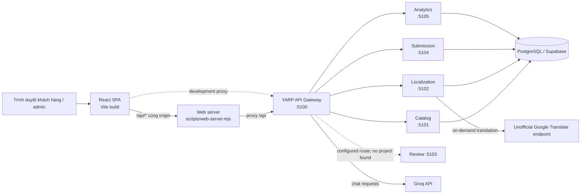

# Kiến trúc hệ thống

## Sơ đồ tổng quan

Trong production, frontend và API có thể cùng origin thông qua web server. Web server chuyển tiếp `/api` đến Gateway; Gateway định tuyến tiếp đến từng backend. Khi phát triển, Vite proxy `/api` thẳng đến Gateway.

## Thành phần

### Frontend

Một React SPA trong `apps/`, khởi chạy tại `apps/main.jsx`; định tuyến trang trong `apps/App.jsx`. `PageTracker` ghi nhận hoạt động trang, còn `ChatWidget` cung cấp giao diện chat. Giao diện gọi API bằng đường dẫn tương đối `/api/...`.

### Web server và gateway

- `scripts/web-server.mjs` phục vụ nội dung `dist`, proxy API và cung cấp health check.
- `services/gateway/` dùng YARP định tuyến API. Gateway có health check, assistant chat/status, CORS, rate limiting và tùy chọn kiểm tra edge secret.
- `Gateway__SharedKey` được các backend hỗ trợ để kiểm soát request nội bộ; biến này không phải cơ chế đăng nhập người dùng admin.

### Backend và dữ liệu

Các backend là ASP.NET Core minimal APIs. Catalog, Localization, Submission và Analytics truy cập PostgreSQL qua Npgsql. Cấu hình kết nối trỏ đến Supabase PostgreSQL trong thiết lập mẫu.

## Luồng request điển hình

1. React gọi `/api/catalog/brands` trên cùng origin.
2. Dev proxy hoặc production web server chuyển request đến Gateway.
3. Gateway bỏ prefix `/api/catalog`, chuyển request đến Catalog.
4. Catalog đọc PostgreSQL và trả JSON về trình duyệt qua cùng chuỗi proxy.

## Chế độ chạy

- `npm run dev`: chỉ frontend; cần backend có sẵn nếu muốn dùng các API.
- `npm run dev:stack`: Vite + Gateway + Catalog + Localization.
- Root `Dockerfile`: frontend build và năm backend service chạy chung container. Cần các biến runtime và PostgreSQL đúng cấu hình.

Chi tiết lệnh và biến môi trường nằm trong [Chạy hệ thống và cấu hình](runtime-and-configuration.md).
