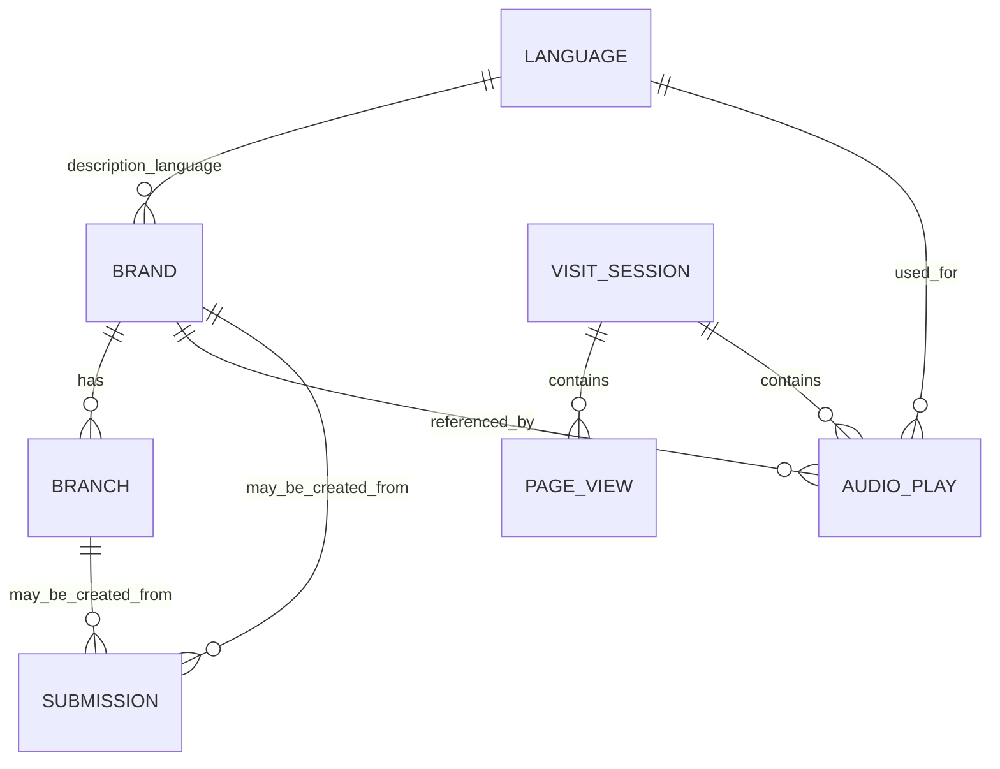

# Mô hình dữ liệu

Schema và các thay đổi PostgreSQL nằm trong `infrastructure/Database/`. Nguồn tạo cấu trúc ban đầu là [`SGCoffeeData.sql`](../../infrastructure/Database/SGCoffeeData.sql); các file migration/seed khác có thể bổ sung hoặc điều chỉnh schema.

## Các bảng chính

| Bảng | Vai trò |
| --- | --- |
| `language` | Danh mục ngôn ngữ |
| `brand` | Thông tin thương hiệu, mô tả và phân loại |
| `branch` | Địa điểm/chi nhánh của thương hiệu; gồm thông tin địa chỉ và tọa độ theo schema |
| `submission` | Đề xuất do người dùng gửi và trạng thái xử lý |
| `visit_session` | Phiên truy cập dùng cho thống kê |
| `page_view` | Sự kiện xem trang trong một phiên |
| `audio_play` | Sự kiện phát audio thương hiệu/ngôn ngữ |

## Quan hệ khái quát

Quan hệ trong sơ đồ thể hiện cách các module dùng dữ liệu; hãy đối chiếu constraint thực tế trong SQL trước khi thay đổi schema.

## SQL hỗ trợ

- `analytics_migration.sql`, `analytics_dashboard_migration.sql` — cấu trúc tracking/dashboard.
- `brand_descriptions_vi_migration.sql` — cập nhật mô tả thương hiệu tiếng Việt.
- `branches_hcm_verified_seed.sql` và `branches_hcm_verified.json` — dữ liệu chi nhánh đã chuẩn hóa.
- `rls.sql` — chính sách Row Level Security.
- `remove_unused_tables.sql` — thay đổi/dọn dẹp bảng theo đợt cập nhật.

Các script không được tự động chạy bởi `npm run dev:stack`. Trước khi áp dụng lên database đang dùng, cần đọc nội dung migration, xác nhận backup và thứ tự chạy. Hướng dẫn chi tiết về schema/chi nhánh: [Database schema and branches](../catalog/database-schema-and-branches.md).
