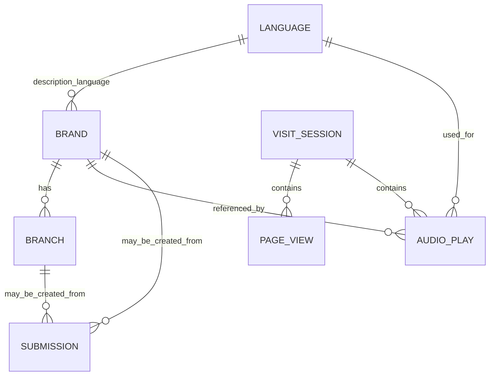

# Mô hình dữ liệu

Schema và các thay đổi PostgreSQL nằm trong `infrastructure/Database/`. Nguồn tạo cấu trúc ban đầu là [`SGCoffeeData.sql`](../../infrastructure/Database/SGCoffeeData.sql); các file migration/seed khác có thể bổ sung hoặc điều chỉnh schema.

## Các bảng chính

| Bảng | Vai trò |
| --- | --- |
| `language` | Danh mục ngôn ngữ |
| `brand` | Thông tin thương hiệu, mô tả và phân loại |
| `branch` | Địa điểm/chi nhánh của thương hiệu; gồm thông tin địa chỉ và tọa độ theo schema |
| `submission` | Đề xuất do người dùng gửi và trạng thái xử lý |
| `visit_session` | Phiên truy cập dùng cho thống kê |
| `page_view` | Sự kiện xem trang trong một phiên |
| `audio_play` | Sự kiện phát audio thương hiệu/ngôn ngữ |

## Quan hệ khái quát

Quan hệ trong sơ đồ thể hiện cách các module dùng dữ liệu; hãy đối chiếu constraint thực tế trong SQL trước khi thay đổi schema.

## SQL

`infrastructure/Database/SGCoffeeData.sql` contains the complete initial schema, Analytics columns and indexes, Vietnamese brand descriptions, categories, branch seed and RLS for the seven application tables. Previously applied migration and cleanup scripts have been removed from the repository.

`branches_hcm_verified.json` retains branch source data. `infrastructure/scripts/generate-branch-seed.py` updates the embedded branch seed in the main SQL file.

Use the main SQL file for a new database. The existing Supabase database already has the updates applied. Running the seed again updates reference data and does not automatically upgrade existing table definitions.
